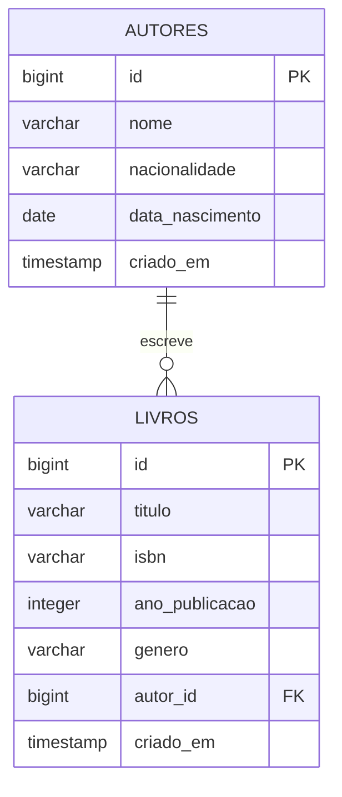

# 📚 Biblioteca Web

Sistema web para cadastro de **Autores** e **Livros** (CRUD completo dos dois).
Cada livro é escrito por um autor, e um autor pode ter vários livros: relacionamento **1 : N**
(`autores` 1 → N `livros`, com a FK `autor_id` na tabela `livros`).

Projeto da disciplina de Engenharia de Software (Prof. Sandro Laudares), Parte 2 do laboratório,
seguindo o mesmo fluxo do projeto Agenda Web.

## Tecnologias

| Camada | Tecnologia |
|---|---|
| Backend | Java 17 + Spring Boot 3.2 (Web, Data JPA, Validation, Lombok) + Maven |
| Frontend | React 18 + React Router 6 + Axios (react-scripts 5) • Node.js 20 + npm |
| Banco de dados | PostgreSQL 15 (desenvolvimento) • H2 em memória (perfil `test`) |
| Testes | JUnit 5 + Mockito (`@WebMvcTest`, `@MockBean`, MockMvc) • `@SpringBootTest` • Jest |
| Versão e CI | Git + GitHub • GitHub Actions |
| Containers | Docker + Docker Compose |

## Modelo de dados



## Estrutura de pastas

```
biblioteca-web/
├── backend/
│   ├── pom.xml
│   ├── Dockerfile
│   └── src/
│       ├── main/java/com/biblioteca/
│       │   ├── BibliotecaApplication.java
│       │   ├── model/        Autor.java, Livro.java
│       │   ├── repository/   AutorRepository.java, LivroRepository.java
│       │   └── controller/   AutorController.java, LivroController.java
│       ├── main/resources/application.properties
│       └── test/
│           ├── java/com/biblioteca/controller/  AutorControllerTest, LivroControllerTest
│           ├── java/com/biblioteca/IntegracaoTest.java
│           └── resources/application-test.properties
├── frontend/
│   ├── package.json, package-lock.json, Dockerfile, nginx.conf
│   ├── public/index.html
│   └── src/
│       ├── App.js, App.css, index.js
│       ├── services/api.js
│       └── components/  AutorList, AutorForm, LivroList, LivroForm
├── docker-compose.yml
├── .github/workflows/ci-cd.yml
└── README.md
```

## Endpoints da API

| Verbo | URL | Ação | Status |
|---|---|---|---|
| POST | `/api/autores` | Cria um autor | 201 |
| GET | `/api/autores` | Lista todos (ordem: nome) | 200 |
| GET | `/api/autores/{id}` | Busca um autor | 200 / 404 |
| PUT | `/api/autores/{id}` | Atualiza um autor | 200 / 404 |
| DELETE | `/api/autores/{id}` | Remove um autor (409 se tiver livros) | 200 / 404 / 409 |
| POST | `/api/livros` | Cria um livro ligado a um autor | 201 |
| GET | `/api/livros` | Lista todos (ordem: título) | 200 |
| GET | `/api/livros/{id}` | Busca um livro | 200 / 404 |
| PUT | `/api/livros/{id}` | Atualiza um livro (inclusive o autor) | 200 / 404 |
| DELETE | `/api/livros/{id}` | Remove um livro | 200 / 404 |
| GET | `/api/livros/autor/{autorId}` | Lista os livros de um autor | 200 |

Exemplo de JSON para criar um livro (o autor vai só com o id):

```json
{ "titulo": "Dom Casmurro", "isbn": "978-8535910667", "anoPublicacao": 1899,
  "genero": "Romance", "autor": { "id": 1 } }
```

Documentação Swagger: http://localhost:8080/swagger-ui.html

## Como executar

### Tudo com Docker (recomendado)

```bash
docker-compose up -d --build
```

- Frontend: http://localhost:3000
- Backend: http://localhost:8080/api/autores
- PostgreSQL: localhost:5432 (banco `biblioteca_db`, usuário/senha `postgres`/`postgres`)

Para parar: `docker-compose down`

### Em modo desenvolvimento

```bash
# 1) banco
docker-compose up -d postgres

# 2) backend (porta 8080)
cd backend
mvn spring-boot:run

# 3) frontend (porta 3000)
cd frontend
npm install
npm start
```

### Testes de aceitação com curl

```bash
curl -X POST http://localhost:8080/api/autores -H "Content-Type: application/json" \
  -d '{"nome":"Machado de Assis","nacionalidade":"Brasileira","dataNascimento":"1839-06-21"}'

curl -X POST http://localhost:8080/api/livros -H "Content-Type: application/json" \
  -d '{"titulo":"Dom Casmurro","isbn":"978-8535910667","anoPublicacao":1899,"genero":"Romance","autor":{"id":1}}'

curl http://localhost:8080/api/livros
```

## Como rodar os testes

```bash
cd backend
mvn test                              # todos
mvn test -Dtest="*ControllerTest"     # unitários (JUnit 5 + Mockito)
mvn test -Dtest="IntegracaoTest"      # integração (@SpringBootTest + H2)

cd frontend
npm test -- --watchAll=false          # Jest
```

O pipeline do GitHub Actions (`.github/workflows/ci-cd.yml`) roda os testes do backend e do
frontend a cada push e pull request na `main`.

## Divisão do trabalho

| Integrante | Responsabilidade | Branch |
|---|---|---|
| Aluno(a) 1 – DEV 1 | CRUD de Autores: `Autor.java`, `AutorRepository`, `AutorController`, `AutorControllerTest`, `AutorList.js`, `AutorForm.js`, estrutura inicial do projeto | `feature/autores` |
| Aluno(a) 2 – DEV 2 | CRUD de Livros: `Livro.java`, `LivroRepository`, `LivroController`, `LivroControllerTest`, `LivroList.js`, `LivroForm.js` | `feature/livros` |

Arquivos comuns (`api.js`, `App.js`, `docker-compose.yml`, CI, README) foram divididos entre a
dupla, e cada um revisou o Pull Request do outro.
